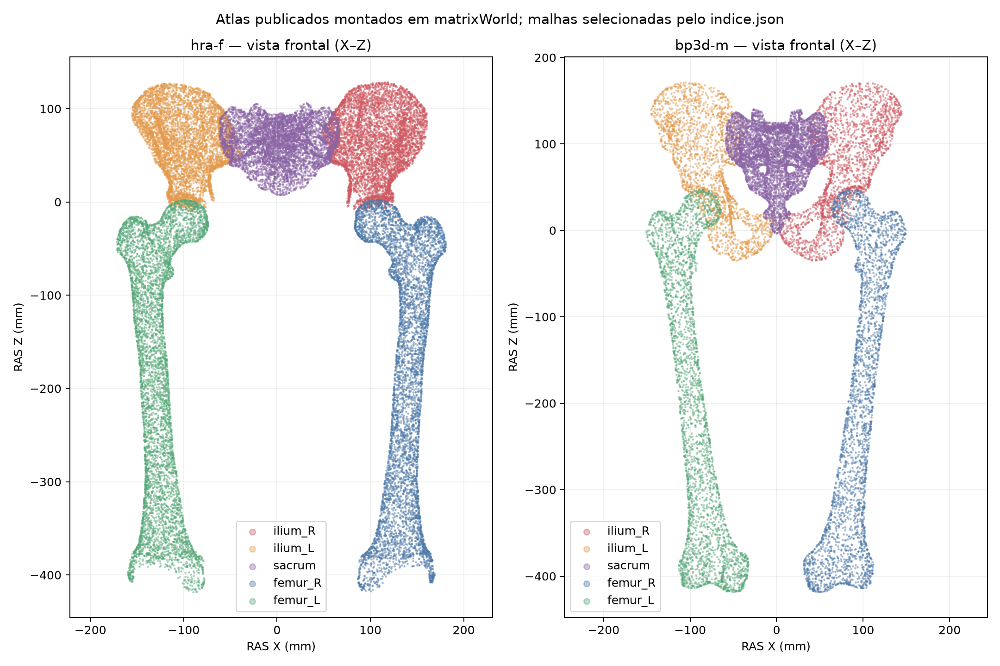

# EXP-0024 — rodada 2

## Síntese

Rodada 2 executada offline, preservando os resultados da rodada 1. O comparador `hra-f` agora usa o sistema esquelético publicado `web/public/atlas/hra-f/1.10-1`; `bp3d-m` usa `web/public/atlas/bp3d-m/4.0-1`. As 31 mulheres QC/Q4 da rodada 1, a divisão dev/val, os parâmetros congelados e as métricas femininas foram reaproveitados sem recálculo. A reposição completou a amostra masculina de 12 para 20 controles.

**Resultado:** V0 passa, V1 passa (AUC 0.8310), V3 passa. V2 é **não avaliável — pelve publicada `hra-f` incompleta**: a cobertura superficial mediana é 52.11%, abaixo de 90%. Veredito: **inconclusivo**, pois V2 não pode ser avaliado segundo a emenda 8.2. Não interpreto essa condição como falha geométrica de V2.

## Montagem dos atlas publicados

`montar_atlas.mjs` lê os manifestos e índices publicados e os GLBs padrão fornecidos em `hra/externo/atlas_extraido/`. A seleção reproduz `montarSistema`/`geometriaDaMalha` em `packages/motor-anatomico/src/pacote.ts`: `GLTFLoader` decodifica os atributos (incluindo accessor quantizado/normalizado); `scene.updateMatrixWorld(true)`; cada `Mesh` é associado ao ancestral mais próximo cujo `userData.name ?? name` existe no índice; posições são transformadas por `matrixWorld`; winding é invertido se o determinante for negativo. As peças são convertidas de metros para milímetros e do referencial do atlas (x esquerda, y cima, z frente) para RAS como na rodada 1. As contagens de triângulos das 10 malhas montadas conferem com `indice.json`.

Peças: `hra-f`: `VH_F_ilium_compact_bone_R`, `VH_F_ilium_compact_bone_L`, `VH_F_sacrum`, `VH_F_femur_R`, `VH_F_femur_L`; `bp3d-m`: `FJ3152`, `FJ3288`, `FJ3393`, `FJ3259`, `FJ3365`. A figura é uma vista frontal X–Z com as posições corporais reconstruídas; cores distinguem quadril direito/esquerdo, sacro e fêmures.

## Cobertura da pelve e espelhamento femoral

Para cada uma das 21 mulheres da validação, a pelve `hra-f` foi alinhada por similaridade ao conjunto feminino (parâmetros congelados). A cobertura foi medida sobre as superfícies `hip_left` e `hip_right` das máscaras: 30.000 amostras por lado, ponderadas pela área real de cada lado, contando pontos a até 5 mm da superfície HRA alinhada. A superfície HRA de referência foi amostrada em 300.000 pontos; nearest-neighbour via cKDTree com `workers=1`.

- Cobertura mediana: **52.11%** (p2,5–p97,5: 41.41%–56.77%; n=21).
- Critério de cobertura: **abaixo de 90%**. Portanto V2 recebe `not_evaluable_incomplete_pelvis`; o comparador não cobre suficientemente a superfície do quadril para o teste previsto.
- `VH_F_femur_R/L` têm 4.517 vértices cada. Reflexão literal em x=0 deixa resíduo médio 5.70 mm e p95 9.45 mm. Pelo plano sagital no ponto médio dos centróides (x RAS = 4.34 mm), o resíduo de vizinho mais próximo é média **2.66 mm**, p95 **3.73 mm**. É uma aproximação de espelho, não uma igualdade exata; o protocolo não define limiar binário para esse teste.

Os valores por caso e lado estão em `cobertura_hra_f.csv`; transformações de alinhamento e distâncias por caso em `resultados.json`.

## Reposição masculina e métricas

Foram mantidos os 12 homens aprovados na rodada 1 e examinada a lista seedada 240025 até completar 20. Foram avaliados 17 candidatos: 9 falharam Q1/Q2; 8 passaram e entraram; nenhum foi removido por duplicidade Q4. Q4 executou ICP em 92 pares elegíveis e pré-filtrou 32 pares por diferença de tamanho de centróide ≥5%; o critério de repetição permaneceu média rígida simétrica <1,0 mm. Nenhuma máscara foi baixada. Os 85 arquivos consultados somam 9,653,738 bytes em disco; hashes individuais em `mascaras_homens_r2_manifest.json`.

M1 médio feminino p2,5–p97,5 mantido: **3.4221–4.7182 mm**.

| Critério | Resultado | Medição |
|---|---|---|
| V0 | **Passa** | 31 mulheres QC/Q4 (21 validação) e 20 homens. |
| V1 | **Passa** | AUC **0.8310** ≥ 0,80; 20 homens contra 21 mulheres de validação. |
| V2 | **Não avaliável** | Cobertura `hra-f` = 52.11% <90%; por emenda 8.2, pelve incompleta. M1 informativo do atlas: 9.5775 mm, mas não usado para aprovar/reprovar V2. |
| V3 | **Passa** | `bp3d-m` M1 médio **5.0211 mm** > p97,5 feminino **4.7182 mm**. |

M3 publicado, como descrição: `hra-f` largura/altura 2.2558, largura/profundidade 1.7159, distância entre cabeças/largura 0.9777; `bp3d-m`: 1.3785, 1.9049, 0.9033. Os M3 de `hra-f` são descritivos porque a pelve incompleta invalida o teste V2.

## Rastreabilidade, desvios e limites

- `resultados.json` registra critérios, métricas por atlas, cobertura, amostra masculina, hashes e parâmetros femininos congelados. `comparacoes_m1.json` contém os alinhamentos e M1 por par; `atlas_surface_samples.npz` contém amostras grandes; `malhas_publicadas.bin/json` preserva a geometria montada e os offsets de vértices/índices.
- A rodada 1 permanece preservada em `../`; o relatório não foi sobrescrito. O protocolo não foi alterado.
- A cobertura usa estimativa por pontos amostrados/cKDTree, e não distância exata ponto-triângulo; o tamanho amostral e pesos por área estão registrados acima. Não houve acesso à rede, instalação de pacotes ou download nesta rodada.
- Revisão humana e validação científica permanecem pendentes. As medidas são computacionais e não constituem validação clínica.
